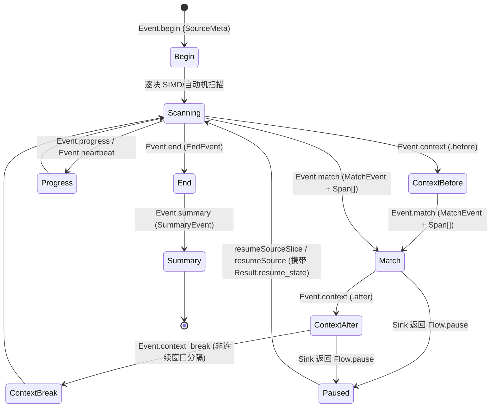

# WebGrep 后端引擎与 `libwebgrep v0.5.0` 原生能力权威规范

> **文档定位**：本文档是 `webgrep` 仓库 Zig 后端（`src/`）接入 [`libwebgrep v0.5.0`](../zig-pkg/libwebgrep-0.5.0-pjEXKraoIQBvFepy4RRet09I9oGa5X6xJDhUMFhJ7y53/) 搜索引擎的**最高工程准则與 API 权威速查手册**，与前端规范 [`docs/FRONTEND_GUIDE.md`](FRONTEND_GUIDE.md) 并列为 AI Agent 与人类开发者的必读总纲。
>
> **核心铁律**：凡是 `libwebgrep v0.5.0` 已经原生提供的**流式搜索管线、断点续扫、无锁匹配器、正则结构化诊断、压缩流透明解压、多字符集嗅探转码、多文件归档直搜、目录遍历与 Glob/Ignore/语言类型过滤**能力，`webgrep` 业务层**必须 100% 委托给 `libwebgrep` 原生接口**，严禁在 `src/` 下重复手写造轮子！

---

## 目录

1. [一、搜索入口选型矩阵与全量预算铁律（Search Entry Matrix & `EngineLimits`）](#一搜索入口选型矩阵与全量预算铁律search-entry-matrix--enginelimits)
   - [1.1 五大搜索入口选型矩阵](#11-五大搜索入口选型矩阵)
   - [1.2 必读陷阱：`serviceConfig` 的 `16 MiB` 默认配额与 `EngineLimits` 覆盖铁律](#12-必读陷阱serviceconfig-的-16-mib-默认配额与-enginelimits-覆盖铁律)
   - [1.3 物理磁盘文件与 `searcher.searchFile` + `optimalBufferSize` + `Scratch`](#13-物理磁盘文件与-searchersearchfile--optimalbuffersize--scratch)
2. [二、流式控制与二阶段注水调度（Pause / Resume & Two-Stage Water-Filling）](#二流式控制与二阶段注水调度pause--resume--two-stage-water-filling)
   - [2.1 `Event` 事件流模型与 `Flow` 三态反压控制](#21-event-事件流模型与-flow-三态反压控制)
   - [2.2 `Result.resume_state` + `Continuation` 精确断点续扫](#22-resultresume_state--continuation-精确断点续扫)
   - [2.3 `webgrep` 超大文件与 8GB 内存设备三大铁律](#23-webgrep-超大文件与-8gb-内存设备三大铁律)
3. [三、无锁只读匹配器体系与结构化编译诊断（Lock-Free `*const` Matchers）](#三无锁只读匹配器体系与结构化编译诊断lock-free-const-matchers)
   - [3.1 五大核心匹配器选型与内部加速机制](#31-五大核心匹配器选型与内部加速机制)
   - [3.2 跨线程并发铁律：强制共享 `*const` 只读指针与线程私有 `Scratch`](#32-跨线程并发铁律强制共享-const-只读指针与线程私有-scratch)
   - [3.3 正则结构化编译诊断（`Regex.initDiagnostic` & `CompileDiagnostic`）](#33-正则结构化编译诊断regexinitdiagnostic--compilediagnostic)
   - [3.4 多条件代价导向（Cost-Based Selectivity）锚点选型](#34-多条件代价导向cost-based-selectivity锚点选型)
4. [四、零落盘多文件归档直搜与流式编解码（Archive & Streaming Codecs）](#四零落盘多文件归档直搜与流式编解码archive--streaming-codecs)
   - [4.1 流式透明解压（`Compression`）与解压炸弹防护](#41-流式透明解压compression与解压炸弹防护)
   - [4.2 多字符集自动嗅探转码（`Encoding`）与 `OffsetMap` / UTF-16 双向映射](#42-多字符集自动嗅探转码encoding与-offsetmap--utf-16-双向映射)
   - [4.3 零落盘多文件归档引擎（`ArchiveTree` / `ArchiveFormat` / `ArchiveOptions`）](#43-零落盘多文件归档引擎archivetree--archiveformat--archiveoptions)
   - [4.4 `webgrep` 归档虚拟路径协议（`archive::entry`）与内存直读预览](#44-webgrep-归档虚拟路径协议archiveentry与内存直读预览)
5. [五、原生目录遍历与过滤子模块（`walk_*` & 有序短路）](#五原生目录遍历与过滤子模块walk_--有序短路)
   - [5.1 `walk_glob`：花括号展开、字面量快速通道与 `!` 取反通配](#51-walk_glob花括号展开字面量快速通道与--取反通配)
   - [5.2 `walk_ignore`：`.gitignore` / `.ignore` 层级作用域与后缀哈希桶](#52-walk_ignoregitignore--ignore-层级作用域与后缀哈希桶)
   - [5.3 `walk_types`：内置 67 种语言类型表与 Glob 展开](#53-walk_types内置-67-种语言类型表与-glob-展开)
   - [5.4 `walk_file_id`：跨平台 `(dev, ino)` 符号链接防环与物理文件去重](#54-walk_file_id跨平台-dev-ino-符号链接防环与物理文件去重)
   - [5.5 `walk_list` 与 `walk_deque`：`32 KiB` 批量目录系统调用与无锁工作窃取](#55-walk_list-与-walk_deque32-kib-批量目录系统调用与无锁工作窃取)
   - [5.6 `stop_on_nonmatch`：有序时序日志 $O(k)$ 短路扫描](#56-stop_on_nonmatch有序时序日志-ok-短路扫描)
6. [六、反模式红线清单（Anti-Patterns — 严禁重复造轮子对照表）](#六反模式红线清单anti-patterns--严禁重复造轮子对照表)
7. [七、`libwebgrep v0.5.0` 全量导出符号速查索引](#七libwebgrep-v050-全量导出符号速查索引)
8. [八、PR 与 AI Agent 自检 Checklist](#八pr-与-ai-agent-自检-checklist)

---

## 一、搜索入口选型矩阵与全量预算铁律（Search Entry Matrix & `EngineLimits`）

### 1.1 五大搜索入口选型矩阵

`libwebgrep v0.5.0` 按数据源介质、并发模型与消费方式分为五大搜索入口。开发后端功能时，必须严格按以下矩阵选型：

| 场景分类 | 首选原生 API | 底层 IO 与内存特征 | 适用场景（`webgrep` 对应模块） |
| :--- | :--- | :--- | :--- |
| **1. 内存切片 / 热缓存 `mmap` 切片流式搜索** | `libwebgrep.searchSourceSlice` / `libwebgrep.resumeSourceSlice` | 零拷贝扫描内存切片；自动处理 `Compression` 解压、`Encoding` 转码、`OffsetMap` 映射与 `Flow.pause` 断点续扫 | `<= 512 MiB` 的 `SearchCache` 热映射文件、内存驻留缓冲区（`src/search_job.zig`） |
| **2. 通用虚拟数据源 / 流式 Reader 搜索** | `libwebgrep.searchSource` / `libwebgrep.resumeSource` | 面向 `libwebgrep.Source`（`.slice` 或 `.reader`）；分块流式读取 + 跨块边界行拼接 | 网络流、管道流、自定义 `Source` 适配器 |
| **3. 物理磁盘未映射文件 / `> 512 MiB` 巨型文件** | `libwebgrep.searcher.searchFile` + `SearchConfig.optimalBufferSize` + `Scratch` | 基于 `pread`（`readPositional`）无锁定位块读取；零 `mmap` 页表开销；稳态 **0 次堆分配** | 未命中热缓存的常规磁盘文件、**所有 `> 512 MiB` 的巨型日志文件**（`src/search_job.zig`） |
| **4. 零落盘多文件归档与目录树搜索** | `libwebgrep.searchArchiveSlice` / `libwebgrep.searchArchive` / `libwebgrep.searchTree` | 内存/流式直接解包 `.tar`、`.tar.gz`、`.tar.zst`、`.tar.xz`、`.zip`，按条目发出带虚拟路径的 `Event` | 归档文件单数据源或目录内归档包免解压直搜（`src/search_job.zig`、`src/file_api.zig`） |
| **5. 调用方主动拉取式迭代（Pull 模型）** | `libwebgrep.openSourcePull` / `libwebgrep.openReaderPull` | 返回 `PullSession` / `ReaderPullSession`，每次调用 `.next()` 步进拉取一条 `?OwnedEvent` | 需要外部协程/状态机逐条消费事件、流式分页器或跨 FFI 桥接场景 |

> [!TIP]
> **辅助轻量入口**：
> - `libwebgrep.searchSlice` / `libwebgrep.searchReader`：底层直接进入 `pipeline.searchSlice` / `pipeline.searchReader`，**不经过** `serviceConfig` 的 `16 MiB` SaaS 默认预算注入，适合纯内部工具或微基准测试。
> - `libwebgrep.openFile(io, dir, sub_path)`：带平台优化标志（如 `NOATIME` 尝试、禁止误打开目录）的安全文件打开辅助函数。
> - `libwebgrep.isBinarySlice(buf)` / `libwebgrep.binaryInspectLen`（`8192` 字节）：与 `BinaryMode` 完全一致的前 8 KiB NUL 字节嗅探函数。

---

### 1.2 必读陷阱：`serviceConfig` 的 `16 MiB` 默认配额与 `EngineLimits` 覆盖铁律

> [!CAUTION]
> **`libwebgrep` 头号陷阱（必读）**：
> 所有高层服务入口（`searchSourceSlice`、`resumeSourceSlice`、`searchSource`、`resumeSource`、`openSourcePull`、`openReaderPull`，以及使用事件 Sink 的 `searchTree` / `searchArchiveSlice` / `searchArchive`）在内部都会调用 `search/config.zig` 中的 `serviceConfig(config)`！
>
> 当 `SearchConfig.limits`（`EngineLimits`）中的预算字段为默认的 `null` 时，`serviceConfig` 会自动填入面向多租户公有云防滥用的**保守默认上限**：
> - `default_max_source_bytes = 16 * 1024 * 1024`（**16 MiB**）
> - `default_max_request_bytes = 16 * 1024 * 1024`（**16 MiB**）
> - `default_max_output_bytes = 1 * 1024 * 1024`（**1 MiB**）
> - `default_time_budget_ns = 30 * std.time.ns_per_s`（**30 秒**）
> - `default_max_decode_bytes = 4 * 1024 * 1024`（**4 MiB**）
> - `default_max_queued_event_bytes = 1 * 1024 * 1024`（**1 MiB**）
> - `default_max_before_bytes = 256 * 1024`（**256 KiB**）

**后果**：如果在 `webgrep` 中调用 `searchSourceSlice` 或 `resumeSourceSlice` 时未显式设置 `limits`（保留为 `null`），任何大于 `16 MiB` 的缓存文件（例如 `100 MiB` 的日志切片）在扫到第 `16 MiB` 时就会触发 `LimitHit.source_bytes` 并**静默提前停止**，导致严重的漏搜！

**强制规范**：在 `webgrep` 本地全量强一致检索引擎中，构造 `libwebgrep.SearchConfig` 时**必须显式传入非 `null` 的 `EngineLimits`** 覆盖 `serviceConfig` 默认值：

```zig
const unlim = std.math.maxInt(u64);

const cfg = libwebgrep.SearchConfig{
    .allocator = allocator,
    .io = io,
    .before_context = before_ctx,
    .after_context = after_ctx,
    .binary = .skip_by_Null,
    .compression = compression_mode,
    .encoding = .auto,
    .emit_utf16_Offsets = false,
    .limits = .{
        // 必须显式设为非 null，防止 serviceConfig 注入 16 MiB / 1 MiB 默认截断！
        .max_source_bytes = unlim,
        .max_request_bytes = unlim,
        .max_output_bytes = unlim,
        .time_budget_ns = unlim,
        .max_decode_bytes = 512 * 1024 * 1024,
        .max_before_bytes = 16 * 1024 * 1024,
        .max_queued_event_bytes = unlim,
        // 压缩流与归档防炸弹上限（按需显式指定）
        .max_decompressed_bytes = 512 * 1024 * 1024,
        .max_compression_ratio = 200,
        .max_context_lines = 100,
        .max_line_len = 16 * 1024 * 1024,
    },
};
```

#### `EngineLimits` 全字段速查表

| 字段名 | 类型 | `serviceConfig` 填 `null` 时的回退值 | `webgrep` 全量检索推荐值 | 触发超限时的 `Result.limit_hit` |
| :--- | :--- | :--- | :--- | :--- |
| `max_source_bytes` | `?u64` | `16 MiB` | `std.math.maxInt(u64)` | `LimitHit.source_bytes` |
| `max_request_bytes` | `?u64` | `16 MiB` | `std.math.maxInt(u64)` | `LimitHit.request_bytes` |
| `max_output_bytes` | `?u64` | `1 MiB` | `std.math.maxInt(u64)` | `LimitHit.output_bytes` |
| `time_budget_ns` | `?u64` | `30_000_000_000` (30s) | `std.math.maxInt(u64)` | `LimitHit.time_budget` |
| `max_decode_bytes` | `?usize` | `4 MiB` | `512 MiB`（与热映射上限对齐） | `LimitHit.decode_bytes` |
| `max_before_bytes` | `?usize` | `256 KiB` | `4 MiB ~ 16 MiB` | `LimitHit.before_bytes` |
| `max_queued_event_bytes` | `?usize` | `1 MiB` | `std.math.maxInt(usize)` | `LimitHit.queued_event_bytes` |
| `max_decompressed_bytes` | `u64` | 默认值 `64 MiB` | 单压缩文件/归档可放宽至 `512 MiB` | `LimitHit.decompressed_bytes` |
| `max_compression_ratio` | `u32` | 默认值 `200` (200:1) | `200` ~ `1000`（防解压炸弹） | `LimitHit.decompressed_bytes` |
| `max_matches` | `?u64` | `null`（不限） | 按查询配额或 `null` | `LimitHit.max_matches` |
| `max_context_lines` | `usize` | 默认值 `64` | `64` ~ `100` | 自动钳制 `before_context` / `after_context` |
| `max_line_len` | `usize` | 默认值 `1 MiB` | `1 MiB` ~ `16 MiB` | `LimitHit.line_too_long`（根据 `long_line_mode` 跳过或截断） |

---

### 1.3 物理磁盘文件与 `searcher.searchFile` + `optimalBufferSize` + `Scratch`

当搜索未进入内存热缓存的普通磁盘文件，或超过 `512 MiB` 的巨型文件时，必须使用 `libwebgrep.searcher.searchFile`：

```zig
const worker_chunk_bytes = libwebgrep.searcher.SearchConfig.optimalBufferSize(worker_count);

// 每个 Worker 线程初始化一个可复用的 Scratch 缓冲池（稳态 0 次堆分配）
var scratch = libwebgrep.searcher.Scratch{};
defer scratch.deinit(gpa);

const res = try libwebgrep.searcher.searchFile(
    io,
    file,
    file_size,
    matcher_ptr, // 传 *const Finder / *const Multi / *const Regex / AnyMatcher
    .{
        .allocator = gpa,
        .chunk_size = worker_chunk_bytes,
        .scratch_pool = &scratch,
        .binary = .skip_by_Null,
        .resume_from = task.resume_offset,
        .continuation = if (task.has_continuation) &task.resume_state else null,
        .limits = engine_limits,
    },
    &sink,
);
```

- **`SearchConfig.optimalBufferSize(threads)`**：
  - 单线程（`threads <= 1`）返回 `1 MiB`（`default_buffer_len`），最大化顺序预读带宽；
  - 多线程并发（`x86_64` / `aarch64` 下 `threads > 1`）返回 **`256 KiB`**（`parallel_buffer_len`），使全部 Worker 的活跃块缓冲区完全驻留在各核心私有 L2 Cache 内，实测将多线程软缺页中断（Minor Page Faults）降低 **4 倍**。
- **`libwebgrep.searcher.Scratch`**：
  - 内部持有一个可复用的行拼接缓冲区 `read_buf` 与一个 `RegexScratch`（DFA/NFA 状态表）。
  - 在 Worker 线程生命周期内跨文件反复传入 `scratch_pool = &scratch`，实现**稳态零堆内存分配（Zero Steady-State Allocations）**。

---

## 二、流式控制与二阶段注水调度（Pause / Resume & Two-Stage Water-Filling）

### 2.1 `Event` 事件流模型与 `Flow` 三态反压控制

`libwebgrep v0.5.0` 将整个检索生命周期抽象为有序的 `libwebgrep.Event` 联合体，并通过 `libwebgrep.Flow` 实现细粒度反压：



#### `Flow` 三态语义

| 返回值 | 含义 | `Result` 状态特征 |
| :--- | :--- | :--- |
| `Flow.cont` | 继续扫描下一行/下一事件 | 正常推进 |
| `Flow.pause` | **软配额让出 / 挂起当前文件** | `res.paused = true`，`res.stopped_reason = .sink_paused`，完整保存 `res.resume_at` 与 `res.resume_state` |
| `Flow.stop` | **彻底终止当前文件或全局任务** | `res.stopped_reason = .caller_stopped`，不再续扫 |

#### Sink 接入的两种标准协议

1. **全事件流协议（推荐用于归档/树搜索与高级管线）**：
   实现 `pub fn event(self: *Self, ev: libwebgrep.Event) libwebgrep.Flow`（或返回 `!libwebgrep.Flow`）。
2. **行回调 + 控制钩子协议（用于高性能单文件 `FileSink`）**：
   实现 `pub fn onMatch(...) bool`、`pub fn onContext(...) bool`，并可选实现 `pub fn control(self: *const Self) libwebgrep.Flow`。当 `onMatch` 达到单文件首轮软配额并返回 `false` 时，管线会立即查询 `sink.control()`：若返回 `.pause`，则进入可恢复暂停状态；若返回 `.stop`，则彻底终止。

---

### 2.2 `Result.resume_state` + `Continuation` 精确断点续扫

当文件因达到 Stage 1 软配额（`SOFT_QUOTA = 64`）或流式节流返回 `Flow.pause` 时，`libwebgrep.Result` 会携带精确的恢复点：

- `result.paused: bool`：是否处于暂停待续扫状态。
- `result.resume_at: ?u64`：在**可搜索 UTF-8 流**中的精确续扫字节偏移（紧跟最后一条已发出事件的换行符之后）。
- `result.resume_state: libwebgrep.ResumeState`（别名 `Continuation`）：
  - `line_number: u64`：下一行的准确行号（无需从文件头重新数 `\n`！）；
  - `bytes_consumed` / `matches` / `matched_lines` / `emitted_lines` / `output_bytes` / `elapsed_ns`：已累计的遥测计数；
  - `saw_match: bool`：供 `stop_on_nonmatch` 跨续扫轮次保持状态；
  - `raw_resume_at: ?u64`：**转码前原始文件字节偏移**（由 `OffsetMap` 反映射得出）。

**断点续扫标准写法**：

```zig
// 方式 A：内存/热缓存切片直接使用 resumeSourceSlice
const next_res = try libwebgrep.resumeSourceSlice(
    slice,
    prev_result, // 自动提取 resume_at 与 resume_state，自动抑制重复的 Event.begin
    matcher_ptr,
    search_cfg,
    &sink,
);

// 方式 B：磁盘文件 searcher.searchFile 显式传入 resume_from 与 continuation
const next_res = try libwebgrep.searcher.searchFile(
    io,
    file,
    file_size,
    matcher_ptr,
    .{
        .allocator = gpa,
        .chunk_size = worker_chunk_bytes,
        .scratch_pool = &scratch,
        .resume_from = prev_result.resume_at orelse 0,
        .continuation = &prev_result.resume_state,
        .limits = engine_limits,
    },
    &sink,
);
```

> [!IMPORTANT]
> **转码文件的零重复开销续扫**：当源文件为 UTF-16LE/BE 或 GB18030 时，`resumeSourceSlice` 会读取 `prev_result.resume_state.raw_resume_at`，仅从原始字节流的断点处向后转码剩余尾部，避免在多轮软配额续扫中反复全量转码整个文件！

---

### 2.3 `webgrep` 超大文件与 8GB 内存设备三大铁律

为确保在 8GB 统一内存的 macOS 设备上同时面对数千个源码小文件与 10GB+ 巨型日志文件（如 13.87GB `10000w.log`）时，既能做到首屏 `< 20ms` 瞬时响应，又绝不发生内核页表抖动（Page-Table Thrashing），必须死守以下三条工程红线：

#### 铁律 1：`> 256 MiB` 二阶段弹性注水调度（Two-Stage Elastic Water-Filling）

- 常量定义：`FileTask.COLOSSAL_FILE_THRESHOLD = 256 * 1024 * 1024`（**256 MiB**）。
- **Stage 1（常规文件快速通道 + 软配额轮转）**：
  - 仅调度 `size <= 256 MiB` 的常规文件（`!task.isColossal()`）。
  - 开启单文件软配额（`use_soft_quota = true`，默认 `SOFT_QUOTA = 64` 条命中）。若某文件命中超过 64 条，通过 `Flow.pause` 挂起并排入续扫队列，让其他小文件优先完成首轮扫描，杜绝单个高密度文件饥饿整个线程池。
  - 若常规文件首轮未扫完，紧接着在 Stage 1 尾部放开软配额（`use_soft_quota = false`）从 `resume_state` 断点处一次性扫完剩余部分。
- **Stage 2（巨型文件专用通道）**：
  - 所有 `size > 256 MiB` 的巨型文件（`task.isColossal()`）**必须归入 `colossal_indices` 在 Stage 2 执行**，严禁混入 Stage 1 抢占常规小文件的 Worker 线程！
  - 在 Stage 2 中，巨型文件直接以 `use_soft_quota = false`（`soft_quota = 0`）全速线性扫描，避免对百兆/十吉字节文件做无意义的暂停与重入。

#### 铁律 2：严禁对 `> 512 MiB` 文件执行 `mmap`（`MAX_HOT_FILE_MAP_BYTES`）

- 常量定义：`search_cache.MAX_HOT_FILE_MAP_BYTES = 512 * 1024 * 1024`（**512 MiB**）。
- **原因**：在 8GB 内存的 macOS 上对 13.87GB 的 `10000w.log` 调用 `MemoryMap.create`（`mmap`），随着多线程 SIMD 扫过全文件，内核会为数百万个 16KB 物理页建立页表项并疯狂挤压活跃进程内存，引发严重的 Page-Table Thrashing 与系统级卡死。
- **强制路径**：
  - `size <= 512 MiB` 且文件热度达标时，允许通过 `SearchCache.getOrMapFileSlice` 建立只读 `mmap` 缓存并走 `searchSourceSlice`；
  - `size > 512 MiB` 时，**100% 禁止任何 `mmap`**（包括禁止在 `FileTask` 局部临时调用 `MemoryMap.create`），必须走 `libwebgrep.searcher.searchFile` + `SearchConfig.optimalBufferSize(worker_count)` + `Scratch` 流式 `pread` 管线！

#### 铁律 3：自适应流式批次爬坡（`1 -> 32 -> 128 -> 512`）

- 后端 WebSocket 流式推送（`maybeFlushStreaming`）采用阶梯式批次阈值：
  - `streaming_batches_sent == 0`：**满 1 条立即推送**（确保首屏 TTFR 极致灵敏）；
  - `streaming_batches_sent == 1`：满 **32 条**推送；
  - `streaming_batches_sent == 2`：满 **128 条**推送；
  - `streaming_batches_sent >= 3`：满 **512 条**推送（最大化吞吐、最小化 JSON 序列化与 WebSocket 帧开销）。

---

## 三、无锁只读匹配器体系与结构化编译诊断（Lock-Free `*const` Matchers）

### 3.1 五大核心匹配器选型与内部加速机制

`libwebgrep v0.5.0` 提供了五种高度特化的匹配器，全部支持 `find(haystack)` 與 `findWithScratch(haystack, scratch)` 统一鸭子类型接口：

| 匹配器类型 | 核心算法与 SIMD 加速机制 | 适用查询形态 |
| :--- | :--- | :--- |
| **`libwebgrep.Finder`** | **4 窗口 `PackedPair` 稀有字节对 SIMD 筛选**（基于字节频率表挑选最低频的 2 个锚点字节，`@Vector(16, u8)` 单次吞吐 64B）+ **Two-Way** $O(n)$ 最坏情况线性时间回退；内置 `CaseMode`（`.sensitive` / `.insensitive` / `.smart`）与 `unicode_case` BMP 全范围大小写折叠（含 `K`$\leftrightarrow$`k`、`ſ`$\leftrightarrow$`s` 跨 ASCII/Unicode 折叠） | 单字面量模式（短语或单个关键词） |
| **`libwebgrep.Multi`** | **4 级自适应多模式架构**：① 单字节退化为 256-bit `ByteSet` 向量查表；② 2~16 个无单字节模式且首尾字节区分度高时采用 `RarePair` SIMD；③ 2~32 个含 `>= 2B` 模式的集合启用 **128-bit Teddy SIMD 向量指纹核**（`vpshufb` / `vtbl` 半字节掩码查表 + 64B 4 窗口展开）；④ 其余或超大规模模式集编译为缓存行对齐的 **Aho-Corasick 256 路全展开 DFA 表**（$O(1)$ 状态转移，无失败链回溯） | 多候选字面量 OR（`init(&patterns, opts)` 或 `initFromText(text, opts)` 按行零拷贝构建），返回 `Match.pattern_id` |
| **`libwebgrep.Regex`** | **混合自动机 + 语法树字面量提取**：① 语法树分析提取必经锚点（单个提取为 `Finder`，分支提取为 `Multi` Teddy SIMD 预过滤，后缀提取为 `Suffix` 反向扫描）；② 预过滤命中后优先在预算可控的 **Lazy DFA**（字节级缓存转移表）上以每字节 1 次查表高速推进；③ 遇到 Unicode 单词边界 `\b` 或复杂断言时无缝切回 **锁步位集 Thompson NFA**；④ 需要精确子匹配边界时在小窗口内运行 **PikeVM** | `/pattern/` 正则表达式（支持 Unicode `\p{...}` 属性、命名捕获组 `(?P<name>...)`、行锚点 `^`/`$`、多行/dotall/crlf） |
| **`libwebgrep.RegexSet`** | 将最多 **1,024 条正则表达式**编译进同一套共享 NFA/DFA 状态机，**单次扫描**同时判定所有命中的正则编号（`matchesInto` / `collectMatchSpansInto`） | 多条独立正则规则同时高亮或策略路由 |
| **`libwebgrep.AnyMatcher`** | 基于编译期生成的只读函数指针表 `anyMatcherVtable(M)` 实现零堆分配类型擦除，将任意自定义匹配器或动态组合包装为统一值类型 | 跨模块统一抽象或插件化匹配器注入 |

---

### 3.2 跨线程并发铁律：强制共享 `*const` 只读指针与线程私有 `Scratch`

> [!CAUTION]
> **并发内存安全红线**：
> 1. `Finder`、`Multi`、`Regex`、`RegexSet` 在 `init` 完成后，其结构体内部均包含指向编译期/堆分配表（如 Aho-Corasick 转移表、NFA 指令数组、提取出的字面量切片）的只读切片，且 **`Finder` 在不区分大小写/Unicode 模式下可能持有指向自身 `folded_storage` 数组的内部切片**！
> 2. **严禁在多线程分发时按值浅拷贝匹配器结构体**（不仅浪费栈拷贝开销，一旦发生结构体移动还会导致自引用切片悬垂）！
> 3. **标准做法**：主线程一次性完成匹配器编译，工作线程一律通过 **`*const` 只读指针**（`*const libwebgrep.Finder`、`*const libwebgrep.Multi`、`*const libwebgrep.Regex` 或 `*const MatcherUnion`）共享访问！
> 4. 正则引擎运行时的全部可变状态（Lazy DFA 缓存状态、`curr_set`/`next_set` 位集、PikeVM 槽位）100% 隔离在每个 Worker 线程私有的 `libwebgrep.RegexScratch`（或 `searcher.Scratch.regex`）中，通过 `regex_ptr.findWithScratch(haystack, &worker_regex_scratch)` 调用，实现**零锁竞争、零原子操作、零堆分配**！

```zig
// ✅ 正确示范：主线程构造一次，Worker 线程共享 *const 指针 + 线程私有 RegexScratch
var regex = try libwebgrep.Regex.init(gpa, pattern, .{
    .case_insensitive = !case_sensitive,
    .unicode = true,
});
defer regex.deinit();

// 在每个 Worker 线程内部：
var regex_scratch = libwebgrep.RegexScratch.init(gpa);
defer regex_scratch.deinit();

if (try regex_ptr.findWithScratch(line_bytes, &regex_scratch)) |m| {
    // m.start .. m.end
}
```

---

### 3.3 正则结构化编译诊断（`Regex.initDiagnostic` & `CompileDiagnostic`）

当用户输入非法正则表达式（例如未闭合括号 `/(foo`、非法重复 `*abc`、无效字符类 `[z-a]` 或未知 Unicode 属性 `\p{Foo}`）时，**严禁仅返回笼统的 `error.InvalidRegex` 字符串**。必须使用 `libwebgrep.Regex.initDiagnostic` 获取精确到字节偏移、行列号与错误分类码的 `libwebgrep.CompileDiagnostic`：

```zig
var diag: libwebgrep.CompileDiagnostic = undefined;
var regex = libwebgrep.Regex.initDiagnostic(gpa, raw_pattern, .{
    .case_insensitive = !case_sensitive,
    .unicode = true,
}, &diag) catch |err| {
    // diag 已填充完整的结构化诊断信息：
    // diag.err           : RegexError (如 error.UnclosedGroup)
    // diag.code          : DiagnosticCode (.unclosed_group, .unexpected_quantifier, .invalid_char_classRange, ...)
    // diag.byte_offset   : 错误发生在 pattern 中的 0-based 字节偏移
    // diag.line          : 1-based 行号
    // diag.column        : 1-based UTF-8 字符列号
    // diag.message       : 人类可读的英文诊断说明 (如 "unclosed group: missing closing ')'")
    // diag.pattern_index : 在 RegexSet.initDiagnostic 中指示第几条模式出错 (单正则为 null)
    return handleRegexCompileError(err, diag);
};
defer regex.deinit();
```

#### `DiagnosticCode` 枚举全集

- `.empty_pattern`：空正则
- `.pattern_too_large`：模式长度超过 `max_pattern_len`（`64 KiB`）
- `.trailing_escape`：末尾悬空反斜杠 `\`
- `.invalid_escape`：非法转义序列（如 `\xGG`、非法的 `\p{...}`）
- `.unclosed_char_class`：字符类 `[...` 未闭合
- `.invalid_char_classRange`：字符类范围逆序（如 `[z-a]`）
- `.unclosed_group`：分组 `(...` 未闭合
- `.unmatched_close_paren`：多余的右括号 `)`
- `.invalid_group_syntax`：非法的命名分组或标志语法 `(?...)`
- `.empty_group_name`：空分组名 `(?P<>...)`
- `.duplicate_group_name`：重复的命名分组
- `.unexpected_quantifier`：量词前无被修饰原子（如 `^*`、`+abc`）
- `.invalid_repetition`：`{m,n}` 语法错误或 `m > n`
- `.repetition_too_large`：`{m,n}` 超过 `max_repeat_limit`（`1,000`）
- `.nesting_too_deep`：括号嵌套深度超过 `max_nesting_depth`（`128`）
- `.program_too_large`：展开后的 NFA 指令数超过 `max_instructions`（`65,536`）
- `.out_of_memory`：内存分配失败

---

### 3.4 多条件代价导向（Cost-Based Selectivity）锚点选型

当用户查询包含多个空格分隔的 AND 词项（如 `error timeout /connection.*reset/`）时：
1. **评估选择性得分（Selectivity Score）**：
   - 字面量词项根据长度、是否含稀有 ASCII/UTF-8 字节（标点、数字、大写字母、罕见字母 `z/q/x/j/k`）计算选择性得分；
   - 正则词项根据定长必经字面量长度、字符类收窄度（`\d`、`[A-Z]`）、行首行尾锚点（`^`/`$`）计算得分，并对含泛化通配 `.*` 的模式施加惩罚。
2. **主驱动锚点（Primary Anchor）先行**：
   - 选出选择性得分最高的词项作为传给 `libwebgrep` 扫描管线的主匹配器（利用 SIMD 瞬间跳过 99.9% 的无关块）；
   - 其余次要正条件（Secondary Positive Terms）按选择性降序排列，仅在主锚点命中的候选行内利用线程私有 `RegexScratch` 执行快速二次校验，并收集所有命中词项的 `MatchRange` 进行合并高亮。

---

## 四、零落盘多文件归档直搜与流式编解码（Archive & Streaming Codecs）

### 4.1 流式透明解压（`Compression`）与解压炸弹防护

`libwebgrep v0.5.0` 原生支持在内存切片与流式 Reader 上透明解压单文件压缩流，**严禁调用外部 `gzip`/`zstd`/`xz` 子进程或写临时文件**！

- **`libwebgrep.Compression` 枚举**：
  - `.none`：当作普通未压缩流处理。
  - `.auto`：通过文件头魔数自动嗅探压缩格式：
    - Gzip（`.gz`）：`1F 8B`
    - Zstandard（`.zst`）：`28 B5 2F FD`
    - XZ（`.xz`）：`FD 37 7A 58 5A 00`
  - `.gzip` / `.zstd` / `.xz`：显式指定压缩算法。
- **`src/file_api.zig` 单流压缩与多文件归档分流识别**：
  - `file_api.detectCompression(path)` -> `?libwebgrep.Compression`：**仅对单文件压缩流**（纯 `.gz` / `.zst` / `.xz`）返回对应的 `Compression`；对于复合归档后缀（`.tar.gz` / `.tgz` / `.tar.zst` / `.tzst` / `.tar.xz` / `.txz` / `.tar` / `.zip`）一律返回 `null`，交由 `file_api.detectArchiveFormat(path)` 处理。
  - `file_api.hasCompressedExtension(path)` -> `bool`：快速判定路径是否带单文件压缩扩展名。
- **解压炸弹双重防护（Bomb Protection）**：
  1. `EngineLimits.max_decompressed_bytes`：限制单流最大解压后字节数（默认 `64 MiB`，`webgrep` 全量模式可设为 `512 MiB`）；
  2. `EngineLimits.max_compression_ratio`：限制最大膨胀比（默认 `200`，即 200:1）。当解压输出超过 `64 KiB` 后，每块都会实时校验 `decompressed_bytes / compressed_bytes_consumed <= max_compression_ratio`。一旦超限，立即平稳停止并返回 `Result.limit_hit = .decompressed_bytes`，绝不触发 OOM。

---

### 4.2 多字符集自动嗅探转码（`Encoding`）与 `OffsetMap` / UTF-16 双向映射

面向跨平台日志（Windows PowerShell 默认 UTF-16LE、传统中文系统 GBK/GB18030、西欧系统 Latin-1/Windows-1252），`libwebgrep v0.5.0` 内置了零外部依赖的 `encoding` 子模块：

- **`libwebgrep.Encoding` 枚举**：
  - `.auto`：自动检测 BOM（UTF-8 `EF BB BF`、UTF-16LE `FF FE`、UTF-16BE `FE FF`）以及无 BOM 的 UTF-16LE/BE 奇偶零字节分布启发式规则（且自动豁免 UTF-16 空字节触发的 `.skip_by_Null` 二进制误判！）。
  - `.none` / `.utf8`：直通零拷贝扫描。
  - `.utf16le` / `.utf16be`：完整支持 BMP 与代理对（Surrogate Pairs）转 UTF-8。
  - `.gbk`：完整覆盖 ASCII、GB2312/GBK 双字节区（`0x81..0xFE`）及 GB18030 四字节扩展区。
  - `.latin1`：ISO-8859-1 / Windows-1252（含 `0x80..0x9F` 欧元符号 `€`、弯引号、破折号等 CP1252 专有映射）。
- **外部 `Content-Type` / 配置标签解析**：
  - `libwebgrep.encoding.fromCharset(label)`：支持大小写与连字符不敏感的 WHATWG 标准标签（如 `"utf-8"`、`"utf-16le"`、`"gb18030"`、`"gbk"`、`"gb2312"`、`"cp936"`、`"windows-1252"`、`"iso-8859-1"`）。
- **`OffsetMap` 双向偏移还原与 UTF-16 索引**：
  - 转码或解压后，`MatchEvent` 与 `ContextEvent` 既提供可搜索 UTF-8 流中的 `byte_offset`，又通过分段线性的 `OffsetMap` 精确计算底层原始文件中的 **`raw_offset: u64`**！
  - 当设置 `SearchConfig.emit_utf16_Offsets = true`（或使用默认事件流）时，`MatchEvent` 与每个 `Span` 还会预计算 `u16_column`、`u16_start`、`u16_end`，可直接传给前端 JavaScript `String.prototype.slice` 或编辑器 API，无需前端再做 UTF-8 $\leftrightarrow$ UTF-16 字节换算。

---

### 4.3 零落盘多文件归档引擎（`ArchiveTree` / `ArchiveFormat` / `ArchiveOptions`）

`libwebgrep v0.5.0` 的 `codec/archive.zig` 与 `search/tree.zig` 提供了纯内存、零磁盘落盘的多文件归档解包与并行检索能力：

#### 支持的归档格式（`libwebgrep.ArchiveFormat`）

| 枚举值 | 支持的扩展名与底层格式 | 内部解析特性 |
| :--- | :--- | :--- |
| `.auto` | 自动根据魔数识别（ZIP `PK\x03\x04`/`PK\x05\x06`、Gzip、Zstd、XZ、TAR `ustar` 签名及 512B 头部八进制校验和） | 未知或无魔数时优雅返回 `ArchiveError.UnsupportedFormat` |
| `.tar` | `.tar` | 兼容 POSIX USTAR `prefix`、PAX 扩展头（`typeflag == 'x'`/`'g'` 下的 `path=` 键值对）与 GNU LongLink（`typeflag == 'L'`）；自动跳过目录/符号链接/设备节点，仅提取普通文件 |
| `.tar_gz` | `.tar.gz`, `.tgz` | 流式 Gzip 解压 + TAR 解包 |
| `.tar_zst` | `.tar.zst`, `.tzst` | 流式 Zstd 解压 + TAR 解包 |
| `.tar_xz` | `.tar.xz`, `.txz` | 流式 XZ 解压 + TAR 解包 |
| `.zip` | `.zip` | 解析末尾 EOCD（End of Central Directory）与中央目录表，校验每个 Local File Header，支持 `Method 0 (Stored)` 与 `Method 8 (Deflate)`，自动跳过加密条目与目录项 |

#### 归档安全防护边界（`libwebgrep.ArchiveOptions`）

| 字段 | 默认值 | 安全防护作用 |
| :--- | :--- | :--- |
| `format` | `.auto` | 指定或自动探测归档格式 |
| `max_entries` | `4,096` | 防止包含百万个空文件的归档耗尽元数据内存（超限返回 `ArchiveError.ArchiveLimit`） |
| `max_entry_bytes` | `16 MiB` | 单个归档条目的最大解压后字节数（`webgrep` 可按需调大） |
| `max_total_bytes` | `64 MiB` | 整个归档包所有条目解压后的累计内存上限 |
| `max_compression_ratio` | `200` | 单条目与外层容器的最大膨胀比（防 Zip Bomb / 42.zip） |
| **内置 Zip-Slip 拦截** | 始终开启 | `sanitizeEntryPath` 强制将 `\` 归一化为 `/`，剥离前导 `./`，并**严厉拒绝任何包含 `..` 父目录越界、以 `/` 开头或含 Windows 盘符 `C:` 的恶意路径**（返回 `ArchiveError.PathTraversal`） |

#### 归档搜索核心 API

```zig
// 1. 直接搜索内存/mmap 归档切片（内部自动构建 ArchiveTree、执行 TreeConfig 过滤并释放）
const summary = try libwebgrep.searchArchiveSlice(
    gpa,
    archive_bytes,
    matcher_ptr,
    .{
        .search = search_cfg,
        .include_globs = include_globs,
        .exclude_globs = exclude_globs,
        .types = type_names,
        .workers = 1, // 在外层已按文件并发时设为 1 防止线程嵌套爆炸
    },
    archive_options,
    &archive_event_sink,
);

// 2. 构建持久化或按需查阅的 ArchiveTree（用于上下文预览或自定义遍历）
var archive_tree = try libwebgrep.ArchiveTree.initFromSlice(gpa, archive_bytes, archive_options);
defer archive_tree.deinit();

// 通过 archive_tree.source().lookup(entry_path) 可 O(1) 取出某条目的解压后切片！
```

---

### 4.4 `webgrep` 归档虚拟路径协议（`archive::entry`）与内存直读预览

为了让用户在搜索 `.tar.gz`、`.tar.zst`、`.tar.xz`、`.zip`、`.tar` 归档包时获得与普通目录文件完全一致的体验（搜索高亮、左侧文件路径胶囊、右侧 `InspectorPane` 上下文行预览），`webgrep` 前后端统一采用 **`::` 双冒号虚拟路径协议**：

1. **`src/file_api.zig` 标准接口与常量定义**：
   ```zig
   pub const ARCHIVE_VIRTUAL_SEP = "::";

   pub const ArchiveVirtualPath = struct {
       archive_path: []const u8,
       entry_path: []const u8,
   };

   pub const default_archive_options = libwebgrep.ArchiveOptions{
       .format = .auto,
       .max_entries = 100_000,
       .max_entry_bytes = 64 * 1024 * 1024,
       .max_total_bytes = 256 * 1024 * 1024,
       .max_compression_ratio = 1000,
   };

   pub fn detectArchiveFormat(path: []const u8) ?libwebgrep.ArchiveFormat
   pub fn isArchivePath(path: []const u8) bool
   pub fn detectCompression(path: []const u8) ?libwebgrep.Compression
   pub fn hasCompressedExtension(path: []const u8) bool
   pub fn splitArchiveVirtualPath(rel_path: []const u8) ?ArchiveVirtualPath
   pub fn sanitizeArchiveEntryPath(raw_entry: []const u8) PathError![]const u8
   pub fn formatArchiveVirtualPathAlloc(
       allocator: std.mem.Allocator,
       archive_path: []const u8,
       entry_path: []const u8,
   ) ![]u8
   ```
   - 完整显示路径（含数据源前缀）：`<source_name>/<archive_rel_path>::<entry_path>`
     - 目录数据源示例：`logs/releases/web-grep-v0.1.7.tar.gz::src/main.zig`
     - 单文件归档数据源示例：`bundle.zip/bundle.zip::config/app.yaml`
2. **搜索阶段（`src/search_job.zig`）**：
   - 通过 `file_api.detectArchiveFormat(path)`（或 `file_api.isArchivePath(path)`）识别归档文件；
   - 调用 `libwebgrep.searchArchiveSlice`（或 `searchArchive`），当某个内部条目 `<entry_path>` 产生 `Event.match` 时，通过 `file_api.formatArchiveVirtualPathAlloc` 将上报给前端的 `file` 字段格式化为 `<display_archive_path>::<entry_path>`。
3. **上下文预览阶段（`src/file_api.zig` -> `/api/context` & `/api/file`）**：
   - `file_api.splitArchiveVirtualPath(rel_path)` 检测路径中是否包含 `"::"`：
     - 若不含 `"::"`：按常规物理文件读取（并自动支持 `.gz`/`.zst`/`.xz` 单文件透明解压与 BOM/字符集转码）；
     - 若含 `"::"`：拆分为 `archive_path` 与 `entry_path`（经 `sanitizeArchiveEntryPath` 二次校验），在内存中通过 `libwebgrep.ArchiveTree` 解包归档并定位对应条目的字节切片，再提取目标行号前后的上下文窗口返回 JSON！
   - **全程零磁盘落盘、零 `/tmp` 临时文件污染、天然免疫并发竞争与磁盘写满风险**。

---

## 五、原生目录遍历与过滤子模块（`walk_*` & 有序短路）

`libwebgrep v0.5.0` 将 ripgrep 级别的目录遍历与路径过滤原语模块化导出为 `walk_glob`、`walk_ignore`、`walk_types`、`walk_file_id`、`walk_list`、`walk_deque`。`webgrep` 的 `src/file_api.zig`、`src/source_registry.zig` 与 `src/search_job.zig` 必须直接调用这些子模块：

### 5.1 `walk_glob`：花括号展开、字面量快速通道与 `!` 取反通配

位于 `libwebgrep.walk_glob`：
- **花括号展开**：
  - `walk_glob.expandBraces(allocator, pattern)` / `expandBracesWithOptions(allocator, pattern, .{ .max_expansions = 1024, .max_output_bytes = 64 * 1024 })`
  - 支持嵌套花括号（如 `src/*.{ts,svelte,{js,mjs}}`），内置指数级爆炸防护（`GlobError.ExpansionLimitExceeded`）。
- **批量编译与优先级评估**：
  - `walk_glob.compileGlobs(allocator, patterns, .{ .case_insensitive = false })` -> `[]Glob`
  - `walk_glob.matchGlobs(compiled, rel_path)` -> `?bool`：采用 ripgrep / gitignore 的**后置规则覆盖前置规则（Last-Match-Wins）**语义，返回 `true`（显式包含）、`false`（由 `!pattern` 显式排除）或 `null`（未命中任何规则）。
- **字面量 $O(1)$ 快速通道（`LiteralClass`）**：
  - `Glob.compile` 会自动将无复杂通配符的常见模式分类为：
    - `.exact_name`（如 `Makefile`）：直接比对 `basename(path)`；
    - `.exact_rel`（如 `src/main.zig`）：直接比对相对路径；
    - `.prefix_dir`（如 `vendor/**`）：直接比对目录前缀；
    - `.suffix`（如 `*.min.js`）与 `.extension`（如 `*.zig`）：直接比对文件名尾部字节，**完全绕过回溯状态机**！

### 5.2 `walk_ignore`：`.gitignore` / `.ignore` 层级作用域与后缀哈希桶

位于 `libwebgrep.walk_ignore`：
- **层级作用域解析（`parseLayerInto`）**：
  - 在递归遍历目录树时，进入子目录 `rel_dir` 即可调用：
    ```zig
    const mark = ignore_set.rules.items.len;
    defer ignore_set.rules.shrinkRetainingCapacity(mark); // 离开子目录时 O(1) 弹出该层规则

    try libwebgrep.walk_ignore.parseLayerInto(
        allocator,
        io,
        dir_handle,
        rel_dir,
        .{ .gitignore = true, .ignore = true, .rgignore = true },
        &ignore_set,
    );
    try ignore_set.build(allocator);
    ```
  - 每条规则自动绑定 `base_dir = rel_dir`，确保子目录 `.gitignore` 中的 `/build` 仅作用于该子目录根，并支持 `!important.log` 反选覆盖。
- **后缀哈希桶加速（`Set.build` & `ext_buckets`）**：
  - `ignore_set.build(allocator)` 会将纯扩展名忽略规则（如 `*.o`、`*.log`、`*.pyc`）按扩展名首字节分桶建立索引，使 90% 的文件在 `ignore_set.isIgnored(rel_path, is_dir)` 中无需遍历全量 Glob 列表。

### 5.3 `walk_types`：内置 67 种语言类型表与 Glob 展开

位于 `libwebgrep.walk_types`：
- 内置 **67 种**标准文件类型定义（`walk_types.builtin`），涵盖：
  - 编程语言：`zig`, `rust`, `c`, `cpp`, `h`, `go`, `py`, `js`, `ts`, `jsx`, `tsx`, `svelte`, `vue`, `java`, `kt`, `scala`, `cs`, `swift`, `rb`, `php`, `lua`, `perl`, `r`, `julia`, `dart`, `elixir`, `erl`, `hs`, `ml`, `ocaml`, `clj`, `lisp`, `zig`, `nim`, `v`, `crystal`, `zig` 等；
  - 配置与数据：`json`, `jsonl`, `yaml`, `toml`, `xml`, `ini`, `cfg`, `conf`, `env`, `csv`, `tsv`, `sql`, `graphql`, `proto`, `tf`, `nix`, `cmake`, `make`, `dockerfile`；
  - 文档与前端/构建产物：`md`, `rst`, `txt`, `tex`, `html`, `css`, `scss`, `less`, `svg`, `sh`, `fish`, `zsh`, `ps1`, `bat`, `log`, `lock`, `minified`, `map`, `wasm`。
- **核心接口**：
  - `walk_types.find("ts")` -> `?Type`（获取该类型的 `globs` 列表，如 `*.ts`, `*.mts`, `*.cts`）；
  - `walk_types.matches("rust", file_name)` / `walk_types.matchesWithTable(custom_types, "svelte", file_name)` -> `bool`；
  - `walk_types.expandTypesToGlobs(allocator, &[_][]const u8{"zig", "md"})`：将类型别名直接展开为 Glob 列表。

### 5.4 `walk_file_id`：跨平台 `(dev, ino)` 符号链接防环与物理文件去重

位于 `libwebgrep.walk_file_id`：
- `walk_file_id.Id`：`struct { dev: u64, ino: u64 }`。
- `walk_file_id.fromDir(io, dir)` / `walk_file_id.fromFile(io, file)`：
  - 在 macOS / Linux / FreeBSD / NetBSD / OpenBSD 上通过 `fstat` 提取 64 位 `(st_dev, st_ino)`；
  - 在 Windows 上通过 `GetFileInformationByHandle` 提取 `(dwVolumeSerialNumber, nFileIndexHigh << 32 | nFileIndexLow)`。
- **用途**：
  1. 在目录遍历开启符号链接追踪或跨源挂载时，维护已访问目录的 `Id` 集合，**100% 阻断符号链接死循环（Symlink Loop Guard）**；
  2. 对指向同一物理 inode 的硬链接/软链接文件做去重，避免重复扫描同一份大文件。

### 5.5 `walk_list` 与 `walk_deque`：`32 KiB` 批量目录系统调用与无锁工作窃取

- **`libwebgrep.walk_list.Lister`**：
  - 常量 `walk_list.buffer_len = 32 * 1024`（`32 KiB`）。
  - 在 Linux（`SYS.getdents64`）与 macOS（`SYS.__getdirentries64`）上直接以 `32 KiB` 缓冲区发起底层批量系统调用，一次系统调用即可取回数百个目录项及其 `d_type`（直接区分 `.directory`、`.file`、`.sym_link`，无需逐个 `stat`）！
  - 标准用法见 `src/source_registry.zig` 与 `src/file_api.zig`：
    ```zig
    var scratch: [libwebgrep.walk_list.buffer_len]u8 align(@alignOf(usize)) = undefined;
    var lister = libwebgrep.walk_list.Lister.init(dir_handle, &scratch);
    var batch: [64]std.Io.Dir.Entry = undefined;
    while (true) {
        const n = try lister.fill(io, &batch);
        if (n == 0) break;
        for (batch[0..n]) |entry| { ... }
    }
    ```
- **`libwebgrep.walk_deque.Deque(T)`**：
  - Chase-Lev 风格并发双端队列，供并行目录树遍历器实现本线程 LIFO 深度优先局部性与空闲线程 FIFO 广度优先半数窃取（Work-Stealing）。

### 5.6 `stop_on_nonmatch`：有序时序日志 $O(k)$ 短路扫描

- `SearchConfig.stop_on_nonmatch: bool = false`：
  - 专为**按时间戳或前缀严格有序聚簇的日志文件**设计。
  - 当设为 `true` 时，扫描器在尚未遇到第一条匹配行前正常推进；一旦产生过至少一次匹配（`saw_match == true`），随后遇到**第一条既不匹配、也不属于 `after_context` 窗口的行**时，立即终止当前文件扫描并标记 `Result.stopped_reason = .nonmatching_line`！
  - 在跨续扫轮次（`resumeSourceSlice` / `resumeSource`）时，`ResumeState.saw_match` 会自动继承该状态。

---

## 六、反模式红线清单（Anti-Patterns — 严禁重复造轮子对照表）

在 `webgrep` 仓库中进行任何后端或全栈开发时，**严禁出现下表左侧的反模式代码**，违者必须在 Code Review / Verifier 阶段打回重构：

| 序号 | ❌ 严禁出现的反模式（Anti-Pattern） | ✅ 标准 `libwebgrep v0.5.0` 原生替代方案 |
| :--- | :--- | :--- |
| **1** | 调用 `searchSourceSlice` / `resumeSourceSlice` / `searchSource` 时将 `SearchConfig.limits` 留空（`null`），导致 `> 16 MiB` 的缓存文件在 16 MiB 处被 `serviceConfig` 静默截断 | **显式构造 `EngineLimits`**，将 `max_source_bytes`、`max_request_bytes`、`max_output_bytes`、`time_budget_ns` 设为 `std.math.maxInt(u64)`，并按需设置 `max_decode_bytes` 与 `max_decompressed_bytes` |
| **2** | 对 `> 512 MiB` 的巨型文件（如 13.87GB `10000w.log`）调用 `MemoryMap.create`（`mmap`），引发 8GB macOS 页表风暴 | 严格检查 `size <= search_cache.MAX_HOT_FILE_MAP_BYTES`（`512 MiB`）；超过 `512 MiB` 强制走 **`libwebgrep.searcher.searchFile` + `SearchConfig.optimalBufferSize` + `Scratch`** |
| **3** | 将 `> 256 MiB` 的巨型文件混入 Stage 1 常规文件队列，或在 Stage 2 中对巨型文件开启 `soft_quota` 反复暂停重入 | 严格使用 `FileTask.isColossal()`（`> 256 MiB`）将巨型文件隔离至 **Stage 2 (`colossal_indices`)**，并以 `use_soft_quota = false` 全速线性扫完 |
| **4** | 在工作线程间**按值浅拷贝** `libwebgrep.Finder` / `Multi` / `Regex` / `RegexSet` 结构体 | 主线程初始化后，所有工作线程一律传递 **`*const` 只读指针**，可变状态放入线程私有的 `libwebgrep.RegexScratch` / `searcher.Scratch` |
| **5** | 用 `Regex.init` 捕获错误后仅返回硬编码字符串 `"Invalid regular expression"`，丢失错误行列号与原因 | 统一使用 **`libwebgrep.Regex.initDiagnostic(gpa, pattern, opts, &diag)`**，将 `CompileDiagnostic` 的 `code`、`byte_offset`、`line`、`column`、`message` 透传至日志或前端提示 |
| **6** | 手写 `.tar` / `.zip` 头部解析、调用外部 `tar`/`unzip`/`gzip`/`zstd` 子进程，或将归档解压到 `/tmp` 临时目录再搜索/预览 | 搜索一律调用 **`libwebgrep.searchArchiveSlice` / `searchArchive`**；上下文预览一律通过 **`file_api.ARCHIVE_VIRTUAL_SEP` (`"::"`) + `libwebgrep.ArchiveTree`** 内存直读 |
| **7** | 在 `src/` 中手写 UTF-16LE/BE BOM 检测、手写 GBK/GB18030/Latin-1 转码表，或手写 Gzip/Zstd/XZ 流解压封装 | 直接配置 `SearchConfig{ .compression = .auto, .encoding = .auto }`，或在预览层调用 **`libwebgrep.decompress.decompressSlice`** 与 **`libwebgrep.encoding.sniff` / `convertAllocWithMap`** |
| **8** | 手写 Glob 通配符匹配器、手写 `{a,b}` 花括号展开、手写 `.gitignore` 解析器或硬编码语言扩展名 `switch` 表 | 100% 委托给 **`libwebgrep.walk_glob`**（`expandBraces`、`compileGlobs`、`matchGlobs`）、**`libwebgrep.walk_ignore`**（`parseLayerInto`、`isIgnored`）与 **`libwebgrep.walk_types`**（`builtin`、`matches`、`expandTypesToGlobs`） |
| **9** | 使用标准库单条 `dir.iterate()` 逐个读取大目录并对每个条目发起 `statFile` 系统调用，或无防环地递归追踪符号链接 | 目录枚举一律使用 **`libwebgrep.walk_list.Lister`**（`32 KiB` 批量 `getdents64`/`__getdirentries64`）；目录去重与防环一律使用 **`libwebgrep.walk_file_id.fromDir` / `fromFile`** |
| **10** | 在暂停后重新从文件偏移 `0` 开始扫描并手动丢弃前 $N$ 条已发送的命中行 | 保存 `Result.resume_at` 与 **`Result.resume_state` (`ResumeState`)**，续扫时调用 **`libwebgrep.resumeSourceSlice` / `resumeSource`** 或传入 `continuation = &prev.resume_state` |

---

## 七、`libwebgrep v0.5.0` 全量导出符号速查索引

以下为 `libwebgrep/src/root.zig` 与 `libwebgrep/src/searcher.zig` 暴露的全部公共符号分类速查：

### 7.1 顶层匹配器与正则诊断（`libwebgrep.*`）

| 符号 | 类型 / 签名 | 说明 |
| :--- | :--- | :--- |
| `Finder` | `type` (`finder.Finder`) | SIMD PackedPair + Two-Way 单模式匹配器（`init`, `initWithCase`, `initUnicodeCase`, `find`, `findWithScratch`, `caseMode`） |
| `CaseMode` | `enum { sensitive, insensitive, smart }` | 大小写模式（`.smart` 在模式不含大写字母时自动忽略大小写） |
| `Match` | `struct { start: usize, end: usize }` | 单模式或正则返回的字节区间 |
| `Multi` | `type` (`multi.Multi`) | 4 级自适应多模式匹配器（`init`, `initFromText`, `deinit`, `find`, `findWithScratch`, `findAll`） |
| `Multi.Options` | `struct { case_mode: CaseMode = .sensitive }` | 多模式构建选项 |
| `Multi.Match` | `struct { start: usize, end: usize, pattern_id: u32 }` | 多模式命中结果（含命中的模式下标 `pattern_id`） |
| `Regex` | `type` (`regex.Regex`) | 混合 Lazy DFA + 锁步 Thompson NFA + PikeVM 正则引擎（`init`, `initDiagnostic`, `deinit`, `isMatch`, `find`, `findWithScratch`, `findAtWithScratch`, `capturesInto`, `captureIndex`, `captureCount`, `captureNames`） |
| `RegexOptions` | `struct` | `case_insensitive`, `multi_line`, `dot_matches_new_line`, `swap_greed`, `crlf`, `unicode` |
| `RegexError` | `error` | 正则编译错误集 |
| `CompileDiagnostic` | `struct` | 结构化正则编译诊断（`err`, `code`, `offset`, `byte_offset`, `line`, `column`, `message`, `pattern_index`） |
| `DiagnosticCode` | `enum` | 17 种正则语法与资源超限诊断码 |
| `RegexScratch` | `type` (`regex.Scratch`) | 线程私有 DFA/NFA 运行时状态池（`init`, `deinit`） |
| `RegexSet` | `type` (`regex.RegexSet`) | 多正则单遍并行匹配集（`init`, `initDiagnostic`, `deinit`, `len`, `isMatch`, `isMatchWithScratch`, `matchesInto`, `matchesWithScratchInto`, `firstMatch`, `firstMatchWithScratch`, `collectMatchSpansInto`） |
| `CaptureSpan` | `struct { start: usize, end: usize }` | 捕获组字节区间 |
| `AnyMatcher` | `type` | 零堆分配类型擦除匹配器接口（`find`, `findWithScratch`, `collectSpans`） |
| `anyMatcherVtable` | `fn (comptime M: type) *const AnyMatcher.VTable` | 为任意匹配器类型生成编译期只读虚表 |

### 7.2 流式搜索配置、事件、源与入口（`libwebgrep.*`）

| 符号 | 类型 / 签名 | 说明 |
| :--- | :--- | :--- |
| `SearchConfig` | `struct` | 搜索管线完整配置（`allocator`, `io`, `chunk_size`, `before_context`, `after_context`, `invert_match`, `line_number`, `byte_offset`, `column`, `only_matching`, `passthru`, `max_count`, `stop_on_nonmatch`, `binary`, `compression`, `encoding`, `charset`, `emit_utf16_Offsets`, `progress_interval_bytes`, `heartbeat_interval_ns`, `long_line_mode`, `resume_from`, `continuation`, `scratch_pool`, `limits`） |
| `EngineLimits` | `struct` | 资源与安全配额（`max_matches`, `max_output_bytes`, `max_line_len`, `max_context_lines`, `max_before_bytes`, `max_decompressed_bytes`, `max_compression_ratio`, `max_source_bytes`, `max_request_bytes`, `time_budget_ns`, `max_decode_bytes`, `max_queued_event_bytes`） |
| `BinaryMode` | `enum { auto, skip_by_Null, stop_by_Null, text }` | 二进制文件检测与处理策略 |
| `Compression` | `enum { none, auto, gzip, zstd, xz }` | 压缩流解压策略 |
| `Encoding` | `enum { auto, none, utf8, utf16le, utf16be, gbk, latin1 }` | 字符编码嗅探与转码策略 |
| `LongLineMode` | `enum { skip, truncate }` | 超长行（`> max_line_len`）处理策略 |
| `LimitHit` | `enum` | 指示触发了哪一项 `EngineLimits` 配额上限 |
| `StoppedReason` | `enum` | `completed`, `max_count`, `caller_stopped`, `sink_paused`, `binary_data`, `nonmatching_line`, `limit_hit` |
| `ResumeState` / `Continuation` | `struct` | 精确断点续扫状态（含 `line_number`, `bytes_consumed`, `matches`, `raw_resume_at` 等） |
| `Result` | `struct` | 单源搜索返回结果（`matches`, `matched_lines`, `emitted_lines`, `bytes_searched`, `raw_bytes_consumed`, `output_bytes`, `elapsed_ns`, `binary_detected`, `limit_hit`, `stopped_reason`, `paused`, `resume_at`, `resume_state`, `detected_encoding`） |
| `Flow` | `enum { cont, pause, stop }` | Sink 事件回调反压控制返回值 |
| `Span` | `struct` | 行内命中高亮区间（`start`, `end`, `u16_start`, `u16_end`, `group`, `pattern_id`） |
| `Event` | `union(enum)` | `begin`, `match`, `context`, `context_break`, `progress`, `heartbeat`, `end`, `summary` |
| `SourceMeta` / `MatchEvent` / `ContextEvent` / `ContextBreakEvent` / `ProgressEvent` / `HeartbeatEvent` / `EndEvent` / `SummaryEvent` | `struct` | `Event` 各分支载荷结构体 |
| `Source` | `union(enum) { slice: SliceSource, reader: ReaderSource }` | 统一搜索输入源描述 |
| `searchSourceSlice` / `resumeSourceSlice` | `fn` | 内存/热映射切片流式搜索与断点续扫 |
| `searchSource` / `resumeSource` | `fn` | 通用 `Source` 流式搜索与断点续扫 |
| `openSourcePull` / `openReaderPull` | `fn` | 创建拉取式 `PullSession` / `ReaderPullSession` 会话 |
| `PullSession` / `ReaderPullSession` / `OwnedEvent` | `type` | 主动拉取式流式会话与自包含事件拷贝 |
| `searchSlice` / `searchReader` | `fn` | 不经过 `serviceConfig` 默认配额覆盖的底层直通搜索函数 |
| `openFile` / `isBinarySlice` / `binaryInspectLen` | `fn` / `usize` | 文件安全打开与前 8 KiB 二进制 NUL 嗅探 |
| `searcher.searchFile` | `fn` | 基于 `pread` + `Scratch` 的物理磁盘文件流式扫描器 |

### 7.3 归档、目录树与编解码子模块（`libwebgrep.*`）

| 符号 | 类型 / 签名 | 说明 |
| :--- | :--- | :--- |
| `ArchiveFormat` | `enum { auto, tar, tar_gz, tar_zst, tar_xz, zip }` | 多文件归档格式枚举 |
| `ArchiveOptions` | `struct` | `format`, `max_entries`, `max_entry_bytes`, `max_total_bytes`, `max_compression_ratio` |
| `ArchiveError` | `error` | `UnsupportedFormat`, `CorruptArchive`, `ArchiveLimit`, `PathTraversal`, `OutOfMemory` |
| `ArchiveTree` | `type` | 内存归档虚拟目录树（`initFromSlice`, `initFromReader`, `deinit`, `source`, `rootNode`） |
| `TreeConfig` | `struct` | 归档/虚拟树搜索配置（`search`, `follow_symlinks`, `max_depth`, `include_globs`, `exclude_globs`, `types`, `ignore_files`, `workers`） |
| `searchTree` / `searchArchiveSlice` / `searchArchive` | `fn` | 虚拟树与多文件归档直搜入口 |
| `decompress` | 子模块 | `decompressSlice`, `decompressSliceWithMap`, `OffsetMap`, `DecompressResult` |
| `encoding` | 子模块 | `sniff`, `fromCharset`, `convertAlloc`, `convertAllocWithMap`, `convertScratchWithMap`, `OffsetMap`, `utf8ToUtf16Offset` |
| `unicode_case` | 子模块 | BMP 全范围大小写折叠与忽略大小写匹配辅助 |
| `walk_glob` | 子模块 | `Glob`, `CompileOptions`, `BraceOptions`, `LiteralClass`, `expandBraces`, `expandBracesWithOptions`, `compileGlobs`, `matchGlobs` |
| `walk_ignore` | 子模块 | `Set`, `Rule`, `LayerFiles`, `LayerSwitch`, `ParseOptions`, `parseInto`, `parseIntoWithOptions`, `parseTextsInto`, `parseLayerInto` |
| `walk_types` | 子模块 | `Type`, `builtin` (67 种语言类型), `find`, `findInTable`, `expandTypesToGlobs`, `matches`, `matchesWithTable` |
| `walk_file_id` | 子模块 | `Id`, `fromDir`, `fromFile`, `eql` |
| `walk_list` | 子模块 | `Lister`, `buffer_len` (`32 KiB`) |
| `walk_deque` | 子模块 | `Deque(T)` 无锁工作窃取双端队列 |

---

## 八、PR 与 AI Agent 自检 Checklist

每次修改 `webgrep/src/` 后端代码后，开发者或 AI Agent 必须逐项核对以下清单：

- [ ] **1. 原生能力核查**：新增或修改的搜索、解压、转码、归档、Glob、`.gitignore`、文件类型过滤逻辑是否 100% 使用了 `libwebgrep v0.5.0` 原生 API？确认未在 `src/` 下手写重复逻辑。
- [ ] **2. `EngineLimits` 显式覆盖**：所有调用 `searchSourceSlice` / `resumeSourceSlice` / `searchSource` / `searchArchiveSlice` 的位置，是否均显式设置了非 `null` 的 `EngineLimits`（彻底消除 `serviceConfig` 默认 `16 MiB` 截断隐患）？
- [ ] **3. 大文件免 `mmap` 与二阶段调度**：
  - `> 512 MiB` 的文件是否 100% 走 `libwebgrep.searcher.searchFile` + `optimalBufferSize` + `Scratch` 且绝不触发 `MemoryMap.create`？
  - `> 256 MiB` 的文件（`FileTask.isColossal()`）是否严格隔离在 Stage 2（`colossal_indices`）且关闭了 `soft_quota`？
- [ ] **4. 匹配器只读共享与结构化诊断**：
  - 跨线程传递匹配器是否全部使用 `*const` 指针 + 线程私有 `RegexScratch`？
  - 正则编译是否使用 `Regex.initDiagnostic` 并保留了 `CompileDiagnostic` 结构化行列信息？
- [ ] **5. 归档零落盘直搜与 `::` 预览**：
  - `.tar` / `.tar.gz` / `.tar.zst` / `.tar.xz` / `.zip` 搜索与 `/api/context`、`/api/file` 预览是否全程基于内存 `searchArchiveSlice` / `ArchiveTree` 与 `::` 虚拟路径，无任何磁盘临时文件？
- [ ] **6. 双线构建与全量测试通过**：
  - `zig build && zig build test` 零警告、零错误通过；
  - `npm --prefix web run test && npm --prefix web run check && npm --prefix web run build` 零警告、零错误通过。
